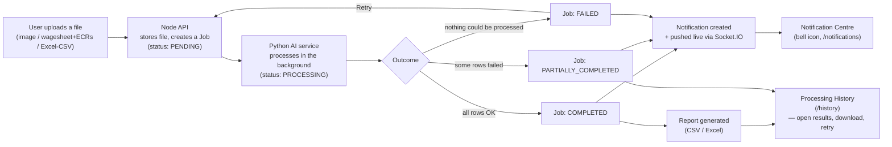
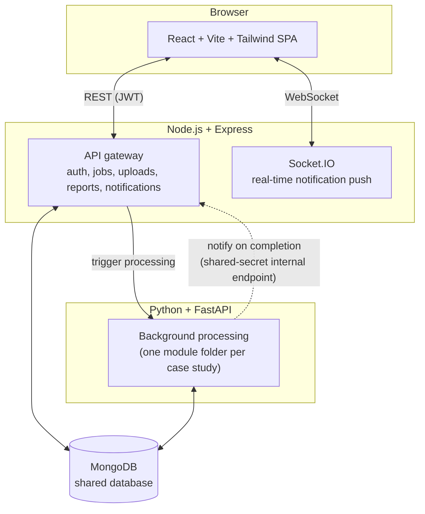

# NexusOps — Operations Intelligence Platform


A centralized AI operations platform built for Prozo's Entrepreneur in
Residence (Agentic AI) take-home case study. Three independent case-study
modules run behind one shared frontend shell, one Node.js API gateway, and
shared backend services — each module registers itself without modifying
the others.

## Table of contents

- [Case studies — start here](#case-studies--start-here)
- [How a batch flows through the platform](#how-a-batch-flows-through-the-platform)
- [Platform-wide features](#platform-wide-features-shared-by-all-three-modules)
- [Quick start](#quick-start-one-time-10-minutes)
- [No paid API keys required](#no-paid-api-keys-required)
- [Architecture](#architecture)
- [Authentication](#authentication)
- [Project structure](#project-structure)
- [Testing](#testing)

## Case studies — start here

| # | Module | Status | README |
|---|---|---|---|
| 1 | Parcel Image Intelligence | Active | [docs/parcel-image-intelligence.md](docs/parcel-image-intelligence.md) |
| 2 | Employee Compliance Verification (PF/ESIC vs. wagesheet) | Active | [docs/employee-compliance-verification.md](docs/employee-compliance-verification.md) |
| 3 | FC Financial Monitor (daily P&L, anomalies, alerts) | Active | [docs/fc-financial-monitor.md](docs/fc-financial-monitor.md) |

Each module's own README has the full "run locally in under 15 minutes"
steps, approach and rationale, known limitations, and what would be
improved with more time. This top-level README covers the *shared*
setup and platform-wide features — do the setup once, then open
whichever module's README you want to exercise.

## How a batch flows through the platform

Every module — a parcel photo batch, a wagesheet+ECR batch, a daily
financial file — moves through the exact same shared pipeline, so this
one diagram describes all three:



The upload request returns immediately — nothing blocks the browser tab
while a batch processes. A user can navigate away and come back later;
[Processing History](#platform-wide-features-shared-by-all-three-modules)
always shows the latest state, and a failed or partially-completed job
can be retried without re-uploading.

## Platform-wide features (shared by all three modules)

- **Notification Centre** (`/notifications`, bell icon in the navbar) —
  real-time (Socket.IO) in-app notifications with severity
  (Info/Success/Warning/Critical), read/unread, and filters, generated on
  processing completed/failed/needs-review, compliance mismatches,
  critical financial anomalies, and digest availability.
- **Processing History** (`/history`) — every job across all three
  modules in one searchable, filterable table (module, status, date
  range, filename), with "Open results", report downloads, and a "Retry"
  action for failed/partially-completed jobs (clears prior partial
  results first, so a retry is never double-counted).
- A stale-job sweep marks any job stuck in PROCESSING for too long as
  FAILED (`JOB_STALE_TIMEOUT_MINUTES`) — a safety net against a hung
  external call, since none of the three modules run under a task queue
  with its own timeout.
- A duplicate-submission guard returns the existing job instead of
  starting a second one if the same user resubmits the same file(s) for
  the same module within a few seconds (double-click / flaky network).

## Quick start (one-time, ~10 minutes)

```bash
git clone <your-repo-url> && cd ai-hub

# 1) MongoDB — pick ONE, both free, no paid tier needed:
#    a) local: brew install mongodb-community && brew services start mongodb-community
#    b) cloud: a free MongoDB Atlas M0 cluster (mongodb.com/cloud/atlas/register)

# 2) Env files
cp backend/node-api/.env.example backend/node-api/.env
cp backend/python-ai/.env.example backend/python-ai/.env
cp frontend/.env.example frontend/.env
# Fill in MONGODB_URI in both backend .env files, and a random JWT_SECRET
# + INTERNAL_API_TOKEN in backend/node-api/.env (copy INTERNAL_API_TOKEN's
# value into backend/python-ai/.env too — both files have a one-liner to
# generate a random value). Everything else has a working default —
# Gemini is optional, see docs/parcel-image-intelligence.md.

# 3) Install dependencies
cd backend/node-api && npm install && cd ../..
cd frontend && npm install && cd ..
cd backend/python-ai && python3 -m venv .venv && source .venv/bin/activate \
  && pip install -r requirements.txt && cd ../..

# 4) Create the first login (safe to re-run)
cd backend/node-api && node scripts/seedAdmin.js you@example.com yourpassword123 && cd ../..

# 5) Start all three services (3 terminals)
cd backend/python-ai && source .venv/bin/activate && uvicorn app.main:app --reload --port 8000
cd backend/node-api && node src/server.js
cd frontend && npm run dev
```

Sign in at `http://localhost:5173` and pick a module from the sidebar.
Sample input files for all three case studies are under `test-data/`, and
sample outputs produced from them are under `test-data/sample-outputs/`.

## No paid API keys required

Every module works end-to-end for free:

- **MongoDB**: local install or Atlas's free M0 tier.
- **Parcel Image Intelligence**: Tesseract OCR (free, local, primary path)
  with an *optional* Gemini vision fallback (free tier, no cost — see its
  README for the tight daily quota to expect).
- **Employee Compliance Verification**: pure PDF/Excel parsing
  (`pdfplumber`/`pandas`/`rapidfuzz`) — no external API calls at all.
- **FC Financial Monitor**: pure rule-based calculation — no external API
  calls at all. Alert delivery (Slack/email/WhatsApp) is optional and uses
  free incoming webhooks, any SMTP account you already have, or the free
  tier of the official Meta WhatsApp Business Cloud API.

## Architecture



Each module's async work (a PDF batch, an image batch, a financial upload)
runs as a FastAPI `BackgroundTask` writing progress to a shared `Job`
document in MongoDB — the upload request returns immediately, the frontend
polls for progress, and a user can navigate away and come back to see the
result without anything freezing. There is no Celery/Redis in this
project: an earlier scaffold for it was removed since every module's
actual processing load fits comfortably in-process (see each module's
README for the explicit tradeoff).

## Authentication

Every API route except `/api/auth/login` requires a valid JWT (see
`backend/node-api/src/middleware/requireAuth.js`). The frontend attaches it
automatically; image/CSV/report URLs that load via a plain ``/`<a>` tag
(which can't carry a header) pass it as a `?token=` query param instead —
same verification, different transport.

There's no public registration — create the first account with:

```bash
cd backend/node-api
node scripts/seedAdmin.js <email> <password> [name]
```

Safe to re-run; it does nothing if that email already has an account.

## Project structure

```
frontend/             React + Vite + Tailwind SPA (one module folder per case study)
backend/node-api/     Express API gateway + shared services (auth, jobs, uploads, reports, notifications)
backend/python-ai/    FastAPI AI/document-processing engine (one module folder per case study)
uploads/              Local file storage (dev; gitignored — runtime data, not source)
test-data/            Sample input files AND sample outputs for all three case studies (tracked)
docs/                 One README per case study, written for this submission
```

## Testing

```bash
cd backend/python-ai && source .venv/bin/activate
pytest app/ -v   # 141 tests across all three modules
```

See each module's README for test counts and what's covered.
